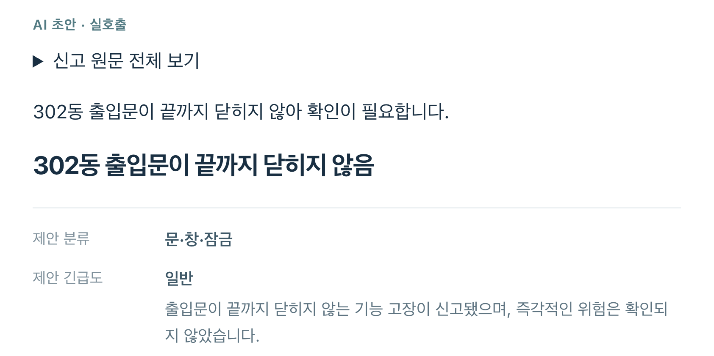
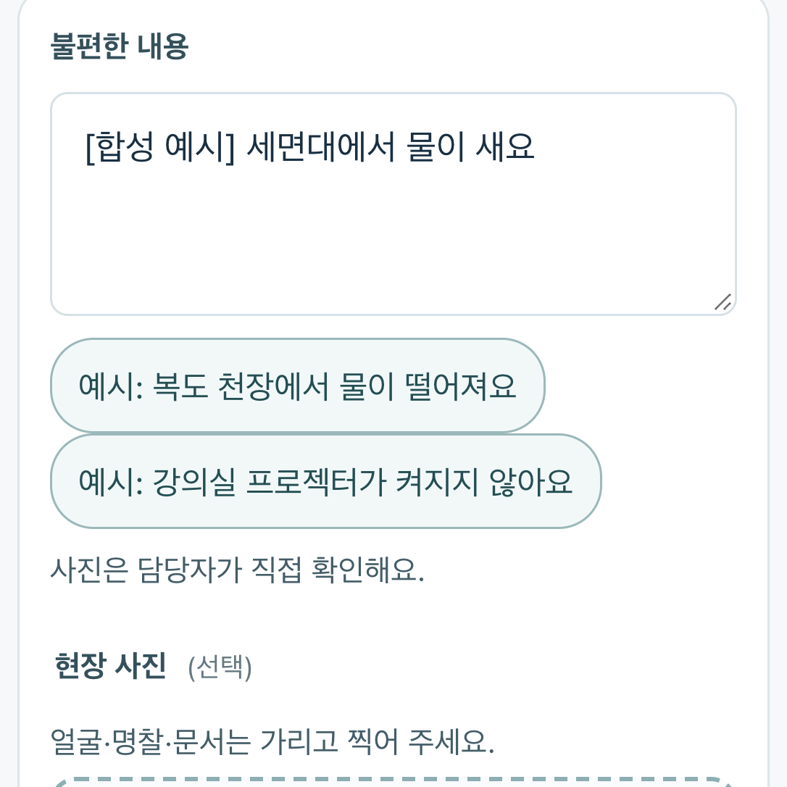
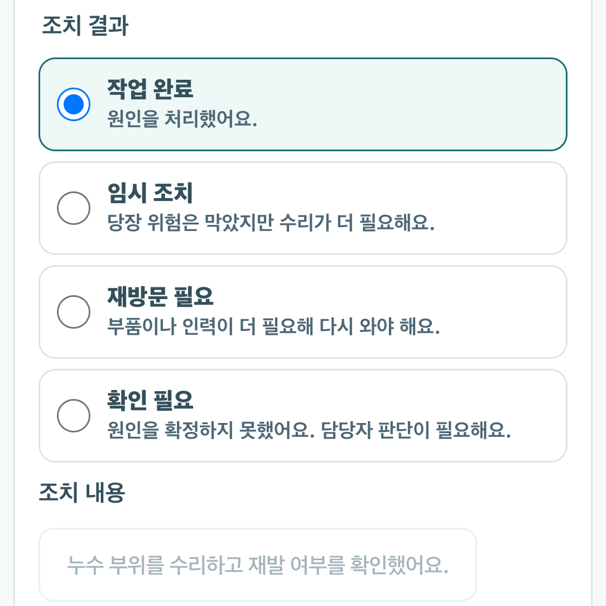
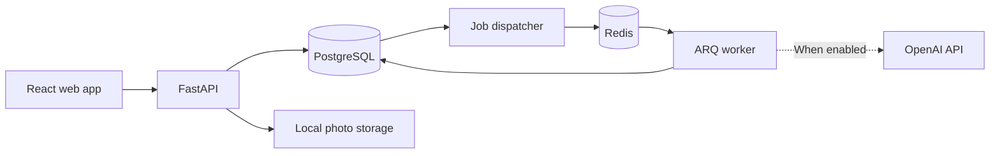

<p align="center">
  
</p>

<h1 align="center">BaroAI · 바로AI</h1>

<p align="center">
  <strong>Campus facilities reporting, from first report to follow-up</strong><br />
  A prototype by Team BRIDGE for the Seoul National University Generative AI Competition
</p>

<p align="center">
  
  
  
  
</p>

<p align="center"><a href="./README.md">한국어</a> · <strong>English</strong></p>

<p align="center">
  <a href="#demo">Demo</a> ·
  <a href="#quick-start">Quick start</a> ·
  <a href="#run-the-live-service">Live service</a> ·
  <a href="#how-data-is-stored">How data is stored</a> ·
  <a href="#contributing">Contributing</a>
</p>

## Demo

The local demo includes 15 synthetic reports at different stages of the workflow. It runs in replay mode with external email disabled. You can try all three roles without creating an account or supplying an API key.

<p align="center">
  
</p>

*The coordinator compares a draft with the original report before acting.*

<details>
<summary>See the reporter and field worker screens</summary>

<p align="center">
  
  
</p>

</details>

## How it works

A reporter describes an issue, optionally adding a photo and a building location. The coordinator reviews the original report and the AI draft, confirms the details, and assigns the work. The field worker records what happened on site. After the coordinator approves the work report, the reporter can see the reply.

| Role | What you can do |
| --- | --- |
| Reporter | Scan a building QR code to start a report. Add location details and a photo, answer follow-up questions, and track your own reports. |
| Coordinator | Compare the original report with the draft summary, category, and urgency. Verify the location, review worker and visit recommendations, and approve work reports before replies reach reporters. |
| Field worker | View your assigned work, visit order, and confirmed location. Record the outcome and continue to the next assignment while the report awaits approval. |

Safety rules check the original report independently of AI and show guidance to call 119 for immediate danger. The server uses factors such as registered buildings, work specialties, and working hours to recommend assignments. Field outcomes distinguish completed work, temporary fixes, return visits, and cases needing review.

## Architecture



React, TypeScript, and Vite power the three role interfaces. FastAPI and SQLAlchemy enforce access rules and manage the records for reports, assignments, and work outcomes. PostgreSQL stores records and job status, Alembic creates and updates the schema, and ARQ workers use Redis to process intake and work report jobs in the background.

## Quick start

Clone the repository or extract the source archive, then run these commands from the directory containing this README. You need **Python 3.12**, **Node.js 22.22.2+ on the 22.x line or 24.15.0+ on the 24.x line**, **pnpm 12.4.2**, and **uv**. The full release demo was tested on macOS with Node.js 26.7.0. [Python version](.python-version) · [Python lockfile](apps/api/uv.lock) · [Web lockfile](apps/web/pnpm-lock.yaml)

### Apple Silicon Mac

Use Homebrew to install the prerequisites and add Node.js to your path.

```sh
brew install python@3.12 postgresql@16 redis node@22 uv
export PATH="$(brew --prefix node@22)/bin:$PATH"
export BARO_PG_BIN="$(brew --prefix postgresql@16)/bin"
```

Install pnpm with `npm install --global pnpm@12.4.2` if needed, then confirm the version with `pnpm --version`. The demo starts its own PostgreSQL and Redis instances, so you can leave the Homebrew services stopped. [Node.js installation](https://nodejs.org/en/download) · [pnpm installation](https://pnpm.io/installation)

### Ubuntu 24.04 LTS

Install the system packages, then run the demo as your regular user.

```sh
sudo apt update
sudo apt install python3.12 postgresql-16 postgresql-client-16 redis-server lsof
export BARO_PG_BIN=/usr/lib/postgresql/16/bin
```

Install a supported Node.js version, pnpm 12.4.2, and `uv`, and make sure all three are on your `PATH`. If PostgreSQL 16 is installed elsewhere, set `BARO_PG_BIN` to the absolute path of the directory containing `initdb`, `postgres`, `psql`, and `pg_isready`. Linux verification covered PostgreSQL binary path selection only. [Ubuntu PostgreSQL 16](https://packages.ubuntu.com/noble/postgresql-16) · [Ubuntu Redis](https://packages.ubuntu.com/noble/redis-server) · [Node.js installation](https://nodejs.org/en/download) · [pnpm installation](https://pnpm.io/installation) · [uv installation](https://docs.astral.sh/uv/getting-started/installation/)

### Install dependencies and start the demo

```sh
UV_PROJECT_ENVIRONMENT="$PWD/.venv" uv sync --project apps/api --locked --python 3.12
pnpm --dir apps/web install --frozen-lockfile
```

Use a short absolute path in a fresh temporary directory for the demo data.

```sh
demo_parent=$(mktemp -d /tmp/baroai-booth.XXXXXX)
demo_parent=$(cd "$demo_parent" && pwd -P)
demo_dir="$demo_parent/run"
printf 'Demo directory %s\n' "$demo_dir"
.venv/bin/python scripts/booth_local.py init "$demo_dir"
.venv/bin/python scripts/booth_local.py run-new "$demo_dir" --campus --seed-showcase
```

Wait for `RUNNING` in the terminal. Find `web_port` in `<run ID>/runtime.json` under the printed demo directory, then open `http://127.0.0.1:<web_port>`. The home screen offers reporter, coordinator, and field worker cards. To try the Administration Building QR entry, add `/report?loc=GWANAK_60` to the same address. To check API and database readiness, open `/api/ready` on that address.

Press `Ctrl+C` to stop the processes started by the demo. The run data stays on disk. To start over with fresh data, repeat the commands with a new temporary directory.

## Run the live service

For school email verification, live OpenAI analysis, and Gmail delivery, use `run-public` in the [service launcher](scripts/service_local.py).

### First-time setup

From the project root, initialize the dedicated database, Redis configuration, and private service settings, then run the migrations. If the service is already configured, use the existing settings.

```sh
.venv/bin/python scripts/dev.py db-init
.venv/bin/python scripts/service_local.py configure
.venv/bin/python scripts/service_local.py migrate
```

- In the generated `.env.service`, set `LLM_FAKE=false` and configure the OpenAI key, text model ID, pricing, and daily budget. [Environment example](.env.example)
- Set `MAIL_DELIVERY=gmail`, `GMAIL_EXTERNAL_ENABLED=true`, and `MAIL_FROM`. The mailbox owner authorizes the `gmail.send` scope with a Desktop OAuth client. [Gmail OAuth tool](apps/api/app/gmail_oauth.py)
- Write the HTTPS origin on a single line in `.local/service/public-origin`, without a path or trailing slash. Set the file mode to `600`. Keep settings and credentials on the machine running the service.

### Start the stack

```sh
.venv/bin/python scripts/service_local.py run-public
```

| Component | Local address and purpose |
| --- | --- |
| Web app | `127.0.0.1:5174` serves the built app and its same-origin `/api` proxy |
| FastAPI | `127.0.0.1:8001` handles authentication, reports, and assignments |
| PostgreSQL | `127.0.0.1:55432` stores reports and work history in the service database |
| Redis | Database 2 at `127.0.0.1:56380` queues AI and mail jobs |
| Background processes | Analysis and mail workers, plus a dispatcher for each queue |

The launcher checks the project PostgreSQL instance and service Redis and starts them if needed. After it prints `Public service ready`, check readiness from another terminal.

```sh
curl -fsS http://127.0.0.1:5174/api/ready
```

Point the Cloudflare Tunnel to `http://127.0.0.1:5174`. On the laptop, use an approved account on the [local staff sign-in page](http://127.0.0.1:5174/staff/login). Any existing reserved demonstration staff accounts are restricted to this loopback address.

For a fresh database, the first coordinator signs in with their school email. The operator uses the verified account's `user.id` to grant the role with the service launcher's `staff-role --user-id <UUID> --expected-role reporter --target-role dispatcher --reason "First coordinator"`. The coordinator signs in again with their school email to approve staff applications.

Startup refuses occupied web or API ports. Press `Ctrl+C` to stop the web app, API, and background processes launched by this command. Service data stays on disk.

## How data is stored

The source release includes the schema migrations and code to generate synthetic data. The demo builds its database locally without a database dump.

1. The launcher initializes an isolated PostgreSQL cluster and database under `postgres/` in the run directory. `runtime.json` records the temporary ports for the web app, API, PostgreSQL, and Redis.
2. Alembic creates the tables for reports, assignments, work outcomes, and authentication. [Database migrations](apps/api/migrations/)
3. The seed script loads the bundled campus catalog, synthetic staff profiles, and 15 synthetic reports. Photos live in the same run's `storage/` directory. [Campus catalog](data/campus-profile/) · [Synthetic seed script](scripts/seed_booth_scenarios.py)
4. The API and background workers use the new database. Reports you submit in the demo are stored there.

The service launcher manages its own local database and credentials, separate from the demo. For development or service setup, use the configuration template and supply live AI or email credentials in that environment as needed. [Service launcher](scripts/service_local.py) · [Configuration template](.env.example)

## Contributing

See the contribution guide for working on the project and running its checks. [Contribution guide](./CONTRIBUTING.md)

| Area | Entry point |
| --- | --- |
| Web app and role screens | [React entry point](apps/web/src/main.tsx) · [Role screens](apps/web/src/product/) |
| API and request/response schemas | [FastAPI entry point](apps/api/app/main.py) · [OpenAPI schema](apps/api/openapi.json) |
| Background jobs and AI gateway | [Job handlers](apps/api/app/jobs.py) · [AI gateway](apps/api/app/services/llm.py) |
| Local demo | [Demo launcher](scripts/booth_local.py) |

Run `pnpm --dir apps/web build` to build the web app to `apps/web/dist/`.

## Data sources and notices

The bundled campus catalog draws on public sources and lists 251 campus locations, with reference coordinates for 73. The app uses estimated travel times. [Seoul National University campus map](https://www.snu.ac.kr/about/campus/map) · [OpenStreetMap notice](apps/web/public/maps/NOTICE.txt)

The project's usage and redistribution terms are pending. Third-party components have their own terms and notices. [Project usage terms](LICENSE) · [Third-party dependency notices](docs/handoff/dependency-licenses.md)
