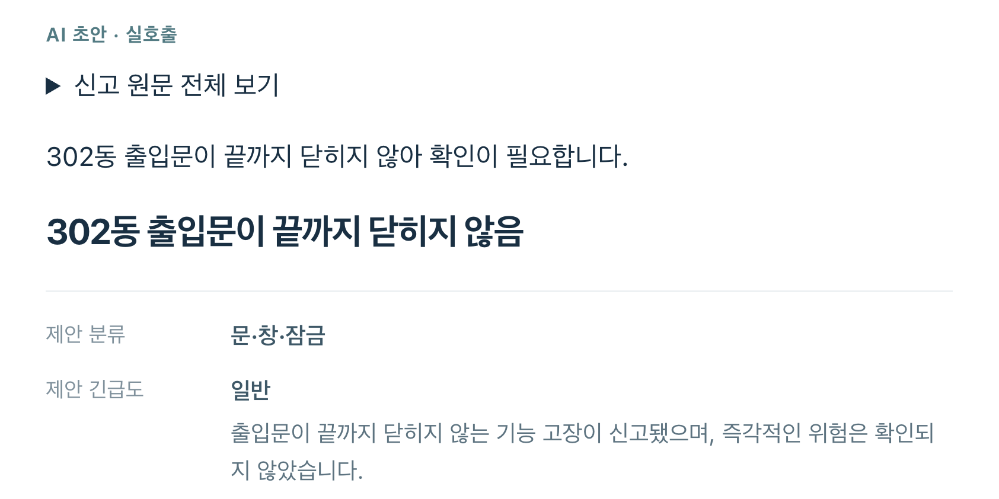
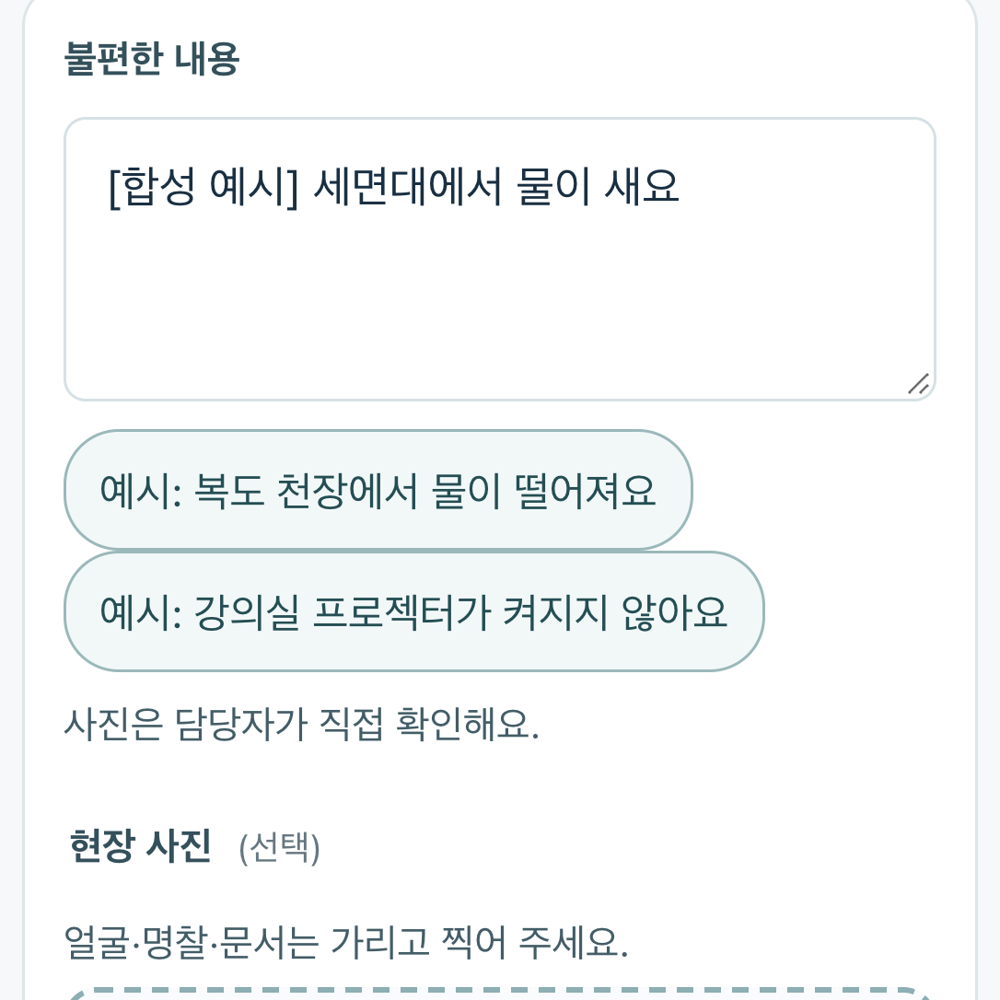
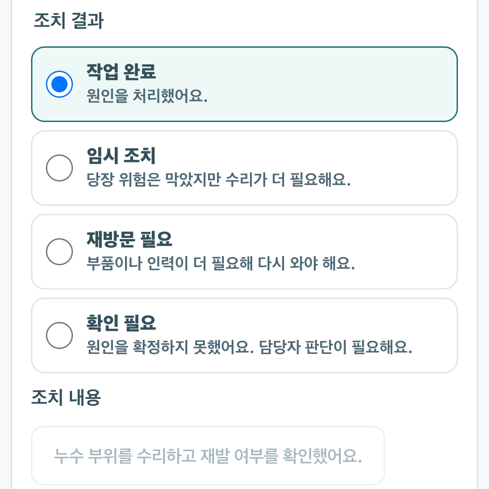
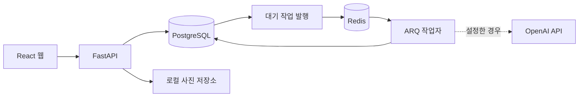

<p align="center">
  
</p>

<h1 align="center">바로AI</h1>

<p align="center">
  <strong>사진과 한 줄로 시작하는 서울대학교 시설 신고</strong><br />
  접수에서 담당자 확인·배정, 현장 조치, 신고자 회신까지 이어집니다.<br />
  서울대학교 생성형 AI 활용 경진대회 · 팀 BRIDGE
</p>

<p align="center">
  
  
  
  
</p>

<p align="center"><strong>한국어</strong> · <a href="./README.en.md">English</a></p>

<p align="center">
  <a href="#시연-화면">시연 화면</a> ·
  <a href="#시작하기">시작하기</a> ·
  <a href="#실제-서비스-실행">실제 서비스</a> ·
  <a href="#데이터-저장-방식">데이터 저장 방식</a> ·
  <a href="#기여하기">기여하기</a>
</p>

## 시연 화면

로컬 시연에는 접수부터 회신까지 여러 상태의 합성 신고 15건이 들어 있습니다. AI는 재생 모드로 실행되고 외부 메일 발송은 꺼져 있습니다. 계정이나 API 키 없이 세 역할을 모두 체험할 수 있습니다.

<p align="center">
  
</p>

*담당자가 합성 신고의 원문과 AI 초안을 나란히 비교합니다.*

<details>
<summary>신고 작성과 작업 보고 화면 보기</summary>

<p align="center">
  
  
</p>

</details>

## 업무 흐름

신고자가 불편 사항을 제출하면 담당자가 원문과 AI 초안을 보고 위치·분류·긴급도를 확인합니다. 작업자가 현장에서 조치를 보고하고 담당자가 승인하면 신고자가 회신을 확인할 수 있습니다.

| 역할 | 할 수 있는 일 |
|---|---|
| 📍 신고자 | 건물 QR로 접수하고 위치·사진을 추가합니다. 내 신고의 추가 질문, 처리 이력과 회신을 확인합니다. |
| 🗂️ 담당자 | 원문과 AI 요약·분류·긴급도 초안을 비교합니다. 등록 위치를 확인하고 추천 작업자와 방문 계획을 검토합니다. |
| 🛠️ 작업자 | 내 작업과 방문 순서, 확정 위치를 확인합니다. 현장 조치 결과를 저장하고 담당자 승인과 별개로 다음 작업을 시작합니다. |

현재 위험에 대한 119 안내는 신고 원문의 안전 규칙으로 판단합니다. 작업자 추천은 등록 건물, 업무 분야와 근무시간 등을 바탕으로 서버에서 계산합니다. 조치 결과는 완료·임시 조치·재방문·확인 필요로 구분합니다.

## 구조



- **React·TypeScript·Vite**는 신고자·담당자·작업자 화면을 제공합니다.
- **FastAPI·SQLAlchemy**는 사용자 권한, 신고·배정·보고와 상태 이력을 관리합니다.
- **PostgreSQL 16·Alembic**은 데이터를 저장하고 DB의 구조를 버전별로 관리합니다.
- **Redis·ARQ**는 접수 분석과 보고 정리를 비동기로 실행합니다. 처리 상태는 PostgreSQL에 저장합니다.

## 시작하기

소스를 내려받아 풀거나 저장소를 복제한 뒤, 이 README가 있는 루트에서 진행합니다. 공통 도구는 Python **3.12**, Node.js **22.22.2 이상인 22.x 또는 24.15.0 이상인 24.x**, pnpm **12.4.2**, `uv`입니다. macOS 검증에는 Node.js 26.7.0을 사용했습니다. Python 패치 버전 기준은 [.python-version](.python-version), 패키지 버전은 [Python 잠금 파일](apps/api/uv.lock)과 [웹 잠금 파일](apps/web/pnpm-lock.yaml)에 있습니다.

### Apple Silicon Mac

Homebrew를 사용하는 Apple Silicon Mac 기준입니다. Python 3.12와 `uv`, 아래의 PostgreSQL·Redis·Node를 준비합니다.

```sh
brew install python@3.12 postgresql@16 redis node@22 uv
export PATH="$(brew --prefix node@22)/bin:$PATH"
export BARO_PG_BIN="$(brew --prefix postgresql@16)/bin"
```

필요하면 `npm install --global pnpm@12.4.2`로 설치하고 `pnpm --version`으로 확인합니다. 시연 실행기가 자체 PostgreSQL과 Redis를 시작합니다. [Node.js 설치](https://nodejs.org/en/download) · [pnpm 설치](https://pnpm.io/installation)

### Ubuntu 24.04 LTS

Ubuntu 24.04 LTS를 기준으로 합니다. 시스템 패키지를 설치한 뒤 로컬 시연 실행은 일반 사용자 계정으로 합니다.

```sh
sudo apt update
sudo apt install python3.12 postgresql-16 postgresql-client-16 redis-server lsof
export BARO_PG_BIN=/usr/lib/postgresql/16/bin
```

위 버전의 Node.js, pnpm과 `uv`를 설치해 `PATH`에서 실행할 수 있도록 합니다. PostgreSQL 16을 다른 위치에 설치했다면 `BARO_PG_BIN`을 `initdb`, `postgres`, `psql`, `pg_isready`가 있는 **절대 디렉터리**로 설정합니다. 배포본의 전체 실행은 macOS에서 확인했고, Linux는 경로 선택 테스트까지 확인했습니다. [Ubuntu PostgreSQL 16](https://packages.ubuntu.com/noble/postgresql-16) · [Ubuntu Redis](https://packages.ubuntu.com/noble/redis-server) · [Node.js 설치](https://nodejs.org/en/download) · [pnpm 설치](https://pnpm.io/installation) · [uv 설치](https://docs.astral.sh/uv/getting-started/installation/)

### 의존성 설치와 시연 시작

```sh
UV_PROJECT_ENVIRONMENT="$PWD/.venv" uv sync --project apps/api --locked --python 3.12
pnpm --dir apps/web install --frozen-lockfile
```

시연 데이터에는 짧은 절대 경로를 사용합니다. 아래 명령으로 새 임시 폴더를 만듭니다.

```sh
demo_parent=$(mktemp -d /tmp/baroai-booth.XXXXXX)
demo_parent=$(cd "$demo_parent" && pwd -P)
demo_dir="$demo_parent/run"
printf '시연 폴더 %s\n' "$demo_dir"
.venv/bin/python scripts/booth_local.py init "$demo_dir"
.venv/bin/python scripts/booth_local.py run-new "$demo_dir" --campus --seed-showcase
```

터미널에 `RUNNING`이 나오면 표시된 시연 폴더 안의 `<실행 ID>/runtime.json`에서 `web_port`를 확인해 `http://127.0.0.1:<web_port>`를 엽니다. 첫 화면에서 신고자·담당자·작업자 역할을 선택할 수 있습니다. 같은 주소에 `/report?loc=GWANAK_60`을 붙이면 행정관 QR 접수를, `/api/ready`를 붙이면 API와 DB의 준비 상태를 확인할 수 있습니다.

`Ctrl+C`를 누르면 시연이 시작한 프로세스가 종료됩니다. 실행 데이터는 디스크에 남습니다. 새 데이터로 시작하려면 새 임시 폴더에서 위 명령을 다시 실행합니다.

## 실제 서비스 실행

위 시연은 합성 자료를 바로 체험하는 방법입니다. 학교 이메일 인증과 실제 OpenAI API·Gmail을 연결하려면 [서비스 실행기](scripts/service_local.py)의 `run-public`을 사용합니다.

### 처음 한 번 준비하기

프로젝트 루트에서 전용 PostgreSQL·Redis와 서비스 설정을 초기화한 뒤 DB 마이그레이션을 적용합니다. 기존에 설정된 서비스라면 아래 초기화는 건너뛰고 현재 설정을 사용합니다.

```sh
.venv/bin/python scripts/dev.py db-init
.venv/bin/python scripts/service_local.py configure
.venv/bin/python scripts/service_local.py migrate
```

- 생성된 `.env.service`에 실호출 설정 `LLM_FAKE=false`, OpenAI 키·텍스트 모델 ID·단가·일 예산을 입력합니다. 설정 이름과 형식은 [환경 변수 예제](.env.example)를 참고하세요.
- `MAIL_DELIVERY=gmail`, `GMAIL_EXTERNAL_ENABLED=true`, `MAIL_FROM`을 설정합니다. 발신 계정 소유자가 데스크톱용 OAuth의 `gmail.send` 권한을 승인합니다. [Gmail 인증 도구](apps/api/app/gmail_oauth.py)
- 루트의 `.local/service/public-origin` 파일에 운영할 HTTPS 원점을 한 줄로 입력합니다. 원점은 경로나 끝 슬래시 없이 입력하고 파일 권한은 `600`으로 둡니다. 설정 파일과 자격 증명은 기기에서 관리합니다.

### 한 번에 실행하기

```sh
.venv/bin/python scripts/service_local.py run-public
```

| 구성 | 로컬 주소와 역할 |
|---|---|
| 웹 | `127.0.0.1:5174`에서 빌드본과 같은 주소의 `/api` 프록시 제공 |
| FastAPI | `127.0.0.1:8001`에서 인증·신고·배정 API 제공 |
| PostgreSQL | `127.0.0.1:55432`의 서비스 DB에 신고·업무 이력 보관 |
| Redis | `127.0.0.1:56380`의 DB 2에서 AI·메일 작업 전달 |
| 백그라운드 작업 | 분석·메일 워커와 각 작업의 전달 프로세스 실행 |

실행기는 기존 프로젝트 PostgreSQL과 서비스 Redis를 확인하고 필요하면 시작합니다. `Public service ready`가 나온 뒤 다른 터미널에서 상태를 확인합니다.

```sh
curl -fsS http://127.0.0.1:5174/api/ready
```

Cloudflare 터널의 연결 대상은 `http://127.0.0.1:5174`입니다. 운영자는 승인된 계정으로 노트북의 [로컬 직원 로그인](http://127.0.0.1:5174/staff/login)을 엽니다. 이미 등록된 가상 직원 계정은 이 루프백에서만 사용할 수 있습니다.

새 DB에서 첫 담당자를 지정하려면 담당자 본인이 학교 이메일로 먼저 로그인합니다. 운영자는 확인한 계정의 `user.id`를 사용해 서비스 실행기의 `staff-role --user-id <UUID> --expected-role reporter --target-role dispatcher --reason "첫 담당자 지정"`으로 역할을 부여합니다. 담당자는 학교 이메일로 다시 로그인한 뒤 직원 가입 신청을 승인할 수 있습니다.

웹·API 포트가 이미 사용 중이면 실행기는 시작을 거부합니다. `Ctrl+C`를 누르면 이번에 실행한 웹·API와 백그라운드 작업을 종료합니다. 서비스 데이터는 디스크에 남습니다.

## 데이터 저장 방식

ZIP에는 **DB 구조를 만드는 마이그레이션과 합성 데이터를 생성하는 코드**가 들어 있습니다. 시연 실행기가 설치한 기기에서 DB를 새로 만듭니다.

1. 실행 폴더의 `postgres/`에 별도 PostgreSQL 클러스터와 전용 DB를 만듭니다. 웹·API·PostgreSQL·Redis의 임시 포트를 `runtime.json`에 기록합니다.
2. [Alembic 마이그레이션](apps/api/migrations/)을 순서대로 적용해 신고·배정·보고·인증에 필요한 테이블을 생성합니다.
3. [기본 캠퍼스 자료](data/campus-profile/)와 합성 직원·신고 15건을 넣습니다. 사진은 같은 실행 폴더의 `storage/`에 저장합니다.
4. API와 Redis 작업 큐가 새 DB를 사용합니다. 처음 신고를 제출하면 그 새 DB에 추가됩니다.

실제 서비스는 [서비스 실행기](scripts/service_local.py)에서 별도 로컬 DB와 자격을 관리합니다. 시연과 서비스에서 각각 만든 신고는 서로 다른 DB에 저장됩니다. [.env.example](.env.example)은 별도 개발·운영 환경의 설정 양식입니다. 실제 AI나 메일을 사용할 계정과 비밀값은 실행하는 환경에서 직접 설정합니다.

## 기여하기

버그 제보, 개선 제안, 변경사항 검증 방법은 [기여 안내](./CONTRIBUTING.md)를 참고하세요.

### 소스 둘러보기

| 경로 | 역할 |
|---|---|
| [apps/api/app/main.py](apps/api/app/main.py) | FastAPI 진입점과 상태 확인 |
| [apps/api/app/jobs.py](apps/api/app/jobs.py) | 접수 분석·작업 보고의 실행, 재시도와 결과 적용 |
| [apps/api/app/services/llm.py](apps/api/app/services/llm.py) | AI 재생, 실제 호출, 입력과 응답 검증 및 계측 |
| [apps/api/openapi.json](apps/api/openapi.json) | API의 요청·응답 형식 |
| [apps/web/src/main.tsx](apps/web/src/main.tsx) | React 앱 시작점 |
| [apps/web/src/product](apps/web/src/product/) | 신고, 접수 검토, 작업자 업무 등 역할별 화면 |
| [scripts/booth_local.py](scripts/booth_local.py) | 별도 DB·Redis·API·웹을 실행·종료하는 시연 도구 |
| [scripts/seed_booth_scenarios.py](scripts/seed_booth_scenarios.py) | 합성 사례의 접수부터 처리 이력까지 생성 |

```sh
pnpm --dir apps/web build
```

웹 빌드는 `apps/web/dist/`에 생성됩니다.

## 자료 출처와 사용 조건

기본 캠퍼스 자료에는 공개 자료를 대조해 정리한 학교 위치 251곳이 들어 있습니다. 이 중 73곳에 대표 좌표가 있으며, 방문 계획에 표시되는 이동시간은 추정치입니다. [서울대학교 캠퍼스맵](https://www.snu.ac.kr/about/campus/map) · [OpenStreetMap 고지](apps/web/public/maps/NOTICE.txt)

프로젝트 이용·재배포 조건은 아직 확정되지 않았습니다. [프로젝트 이용 조건 안내](LICENSE)와 [제3자 의존성 고지](docs/handoff/dependency-licenses.md)를 확인할 수 있습니다.
